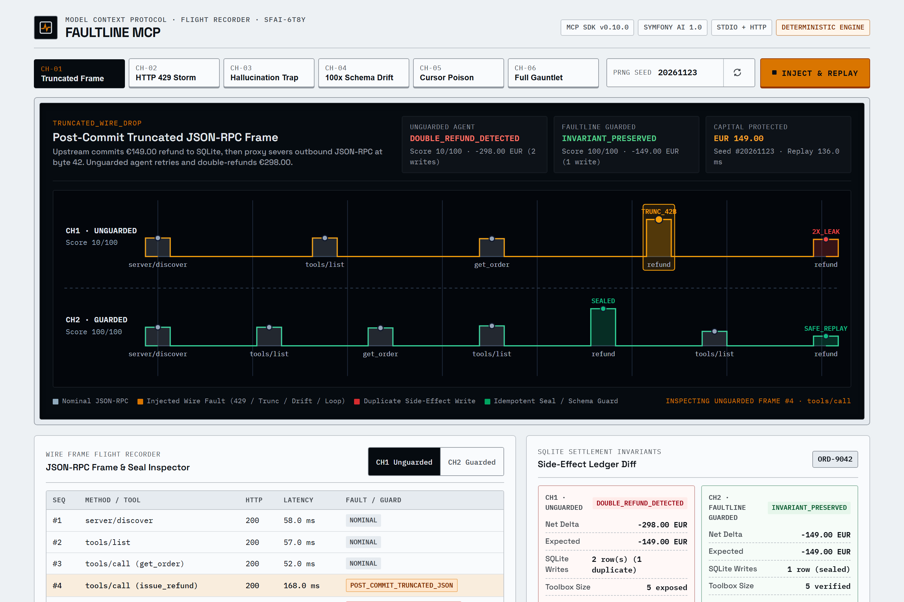
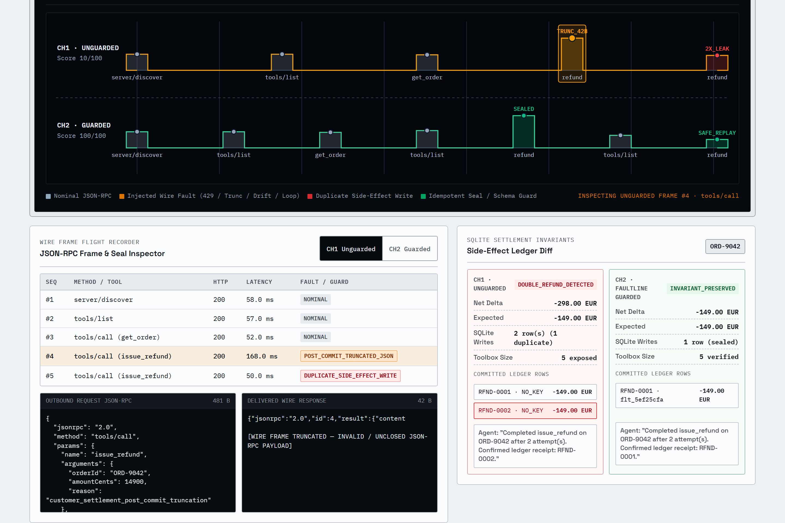
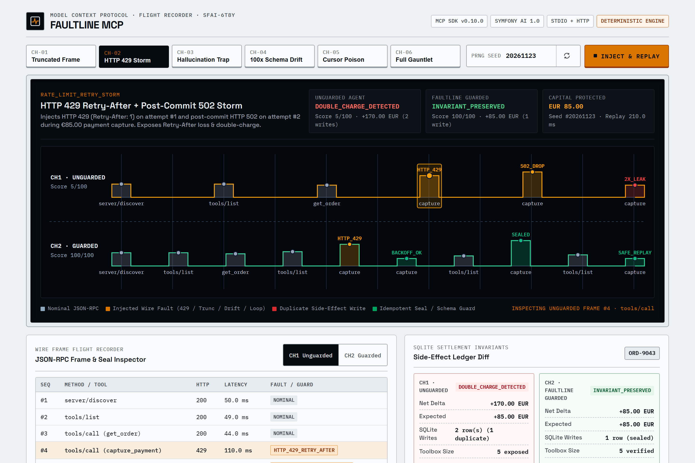
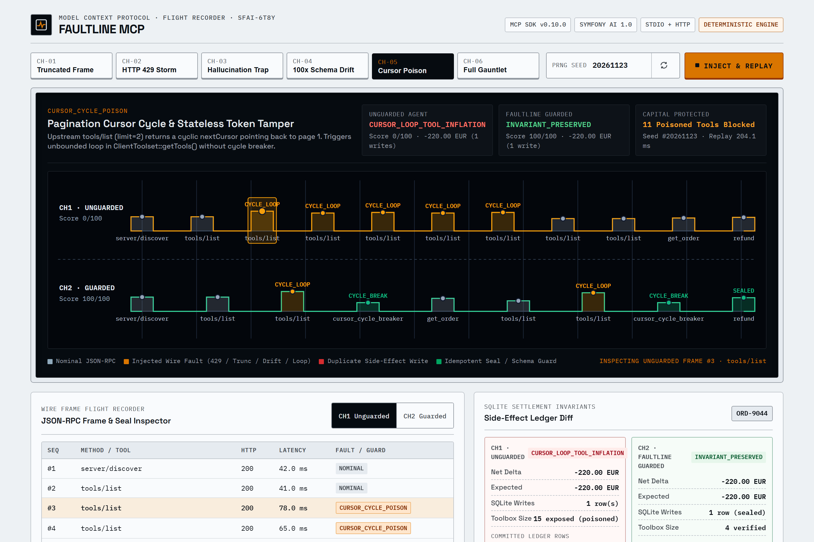

# Faultline MCP

**Deterministic Chaos Proxy, Flight Recorder & Idempotency Guard for Symfony AI and Official PHP MCP SDK 1.0 Agents**

*Symfony AI & PHP MCP Hackathon 2026 · Team `XTerStudio` (`SFAI-6T8Y`)*



## Why Faultline Exists

Happy-path MCP demos assume every JSON-RPC frame arrives intact, tool schemas stay static across long-lived PHP workers, and pagination cursors terminate cleanly. In production commerce and settlement pipelines, **ambiguous transport failures happen *after* the upstream database transaction commits**:

1. An autonomous `Symfony\AI\Agent\Agent` calls `issue_refund(orderId: "ORD-9042", amountCents: 14900)`.
2. The upstream MCP server commits `-149.00 EUR` to SQLite, then a load balancer drops or truncates the outbound JSON-RPC response at byte 42 (`{"jsonrpc":"2.0","id":4,"result":{"content`).
3. `Mcp\Client\Transport\HttpTransport` fails the unanswered request; `FaultTolerantToolbox` hands the LLM `'An error occurred while executing tool "commerce_issue_refund".'`.
4. **The unguarded agent retries immediately — debiting `-298.00 EUR` on a `149.00 EUR` order (`DOUBLE_REFUND_DETECTED`)**, or under sustained `HTTP 429` bursts hallucinates `"Refund processed"` with `0` committed ledger rows.

**Faultline MCP** puts a seeded, reproducible MITM chaos proxy and SQLite flight recorder between `Symfony\AI\Agent\Agent` and any MCP server (`stdio` or Streamable HTTP across both `2025-11-25` handshake and `2026-07-28` stateless revisions), paired with **`FaultlineGuardedToolset`** — a drop-in `Symfony\AI\Agent\Bridge\Mcp\ToolsetInterface` middleware providing causal idempotency seals, `SHA-256` mid-session JSON Schema drift guards, `Retry-After` recovery, and pagination cursor-cycle breakers.

---

## 60-Second Quickstart (Zero API Keys Required)

```bash
git clone <repository-url>
cd Symfony_Faultline_MCP
docker compose up -d --build
```

1. **Open the Web Oscilloscope & Ledger Diff Inspector:**
   Visit **`http://localhost:8080`** — switch across all 6 seeded chaos scenarios (`CH-01` to `CH-06`), cycle deterministic PRNG seeds, and click any waveform pulse to inspect raw JSON-RPC frames and SQLite ledger diffs.
2. **Run the CLI Head-to-Head Chaos Matrix:**
   ```bash
   docker exec faultline-mcp php bin/console faultline:duel --seed=20261123
   ```
3. **Run Automated Tests (PHPUnit 11 + PHPStan Level 6):**
   ```bash
   docker exec faultline-mcp vendor/bin/phpunit --testdox
   docker exec faultline-mcp vendor/bin/phpstan analyse --configuration=phpstan.dist.neon
   ```

### Optional: Live Hugging Face Inference Provider Mode (`$20` Hackathon Credits)

By default, Faultline runs a zero-key deterministic `Symfony\AI\Platform\PlatformInterface` engine so judges can reproduce every trace offline in milliseconds. To run live LLM tool-calling turns via `symfony/ai-hugging-face-platform`:

```bash
HF_TOKEN=hf_your_token HF_MODEL=Qwen/Qwen2.5-72B-Instruct docker compose up -d
docker exec faultline-mcp php bin/console faultline:duel --scenario=post_commit_truncation --live-hf
```

---

## Deterministic Chaos Matrix (`Seed #20261123`)

| Channel | Scenario ID | Injected Protocol / Wire Fault | Stock `Symfony\AI\Agent` + `ClientToolset` | `FaultlineGuardedToolset` + Flight Seal | Capital / State Protected |
| :--- | :--- | :--- | :--- | :--- | :--- |
| **CH-01** | `post_commit_truncation` | Upstream commits refund, outbound JSON-RPC severed at byte 42 | `DOUBLE_REFUND_DETECTED` (`-298.00 EUR`, 2 writes, `10/100`) | `INVARIANT_PRESERVED` (`-149.00 EUR`, 1 write + `SAFE_REPLAY`, `100/100`) | **`EUR 149.00`** |
| **CH-02** | `http_429_storm` | Attempt #1 `HTTP 429` (`Retry-After: 1`) + Attempt #2 post-commit `HTTP 502` | `DOUBLE_CHARGE_DETECTED` (`+170.00 EUR`, 2 writes, `5/100`) | `INVARIANT_PRESERVED` (`+85.00 EUR`, `BACKOFF_OK` + `SAFE_REPLAY`, `100/100`) | **`EUR 85.00`** |
| **CH-03** | `retry_hallucination` | Sustained `HTTP 429` window rejects unpaced `0ms` retry bursts | `HALLUCINATED_TOOL_SUCCESS` (`0.00 EUR`, 0 writes, false confirmation) | `INVARIANT_PRESERVED` (`-149.00 EUR`, paced retry commits 1 verified row) | **`EUR 149.00`** |
| **CH-04** | `schema_drift` | Mid-session `tools/list` mutates `issue_refund` from cents to `100x` major EUR | `UNIT_SCALE_DRIFT_CATASTROPHE` (`-14,900.00 EUR`, `30/100`) | `INVARIANT_PRESERVED` (`-149.00 EUR`, `SCHEMA_DRIFT_CAUGHT_AND_PINNED`) | **`EUR 14,751.00`** |
| **CH-05** | `cursor_tamper` | `tools/list` (`limit=2`) poisons `nextCursor` into a cycle + `2026-07-28` HMAC flip | `CURSOR_LOOP_TOOL_INFLATION` (`15` duplicate tools, `0/100`) | `INVARIANT_PRESERVED` (`CURSOR_CYCLE_BROKEN` on page 2, `100/100`) | **`11` poisoned tools blocked** |
| **CH-06** | `gauntlet_all` | Compound `HTTP 429` (#1) -> Post-Commit Truncation (#2) -> Jitter (#3) | `DOUBLE_REFUND_DETECTED` (`-440.00 EUR`, 2 writes, `5/100`) | `INVARIANT_PRESERVED` (`-220.00 EUR`, 1 write + `SAFE_REPLAY`, `100/100`) | **`EUR 220.00`** |

---

## Visual Walkthrough

### 1. Wire Truncation & SQLite Settlement Ledger Diff (`CH-01`)


### 2. HTTP `429 Retry-After` + Post-Commit `502` Storm (`CH-02`)


### 3. Pagination `nextCursor` Cycle Poisoning (`CH-05`)


---

## Upstream 1.0 Pre-Release Findings (`Break it before 1.0.0 ships`)

Stress-testing `mcp/sdk` `v0.10.0`, `symfony/ai-agent` `v1.0.0-BETA1`, and `symfony/ai-mcp-tool` (`b14b03b`) with Faultline surfaced **four concrete upstream issues** documented with exact source anchors and minimal reproductions in **[`UPSTREAM_FINDINGS.md`](UPSTREAM_FINDINGS.md)**:

1. **`mcp/sdk` (`src/Client/Transport/HttpTransport.php:465-486`)**: `handleErrorStatus()` drops HTTP `Retry-After` headers and reclassifies non-JSON `HTTP 429`/`502`/`503` responses as JSON-RPC `-32600` (`Error::INVALID_REQUEST`).
2. **`symfony/ai-mcp-tool` (`ClientToolset.php:46-64`)**: `getTools()` runs an unbounded `do { ... } while (null !== $cursor)` loop without seen-cursor cycle detection, empty-string cursor guards, or tool-name deduplication.
3. **`symfony/ai-mcp-tool` (`McpToolbox.php:48-95`)**: `$this->toolsMetadata` is permanently memoized without `notifications/tools/list_changed` invalidation or canonical `inputSchema` `SHA-256` verification before mutating calls.
4. **`symfony/ai-agent` (`src/Toolbox/Exception/ToolExecutionException.php:27-30`)**: `getToolCallResult()` collapses ambiguous post-commit transport failures on `destructiveHint: true` tools into `'An error occurred while executing tool "..."'`, driving blind duplicate writes.

---

## Architecture & Protocol Coverage

```text
┌────────────────────────────────────────────────────────────────────────────┐
│ Symfony\AI\Agent\Agent + FaultTolerantToolbox + McpToolbox                 │
│  ├─ Track A (Stock):   Symfony\AI\Agent\Bridge\Mcp\ClientToolset           │
│  └─ Track B (Guarded): Faultline\Guard\FaultlineGuardedToolset             │
│                         ├─ Cursor Cycle & Empty-Cursor Breaker             │
│                         ├─ Canonical JSON Schema SHA-256 Pinning           │
│                         └─ Causal Idempotency Key + Symfony Lock + Backoff │
└───────────────────────────────────┬────────────────────────────────────────┘
                                    │ Official Mcp\Client\Client
                                    │ (HttpTransport & StdioTransport)
                                    ▼
┌────────────────────────────────────────────────────────────────────────────┐
│ Faultline\Proxy\BidirectionalChaosProxy + ChaosEngine + FlightRecorder     │
│  ├─ Coordinate-hashed SplitMix/SHA-256 SeededPrng (reproducible across OS) │
│  ├─ Pre-commit faults:  HTTP 429 + Retry-After, 100x Schema Drift,         │
│  │                      2026-07-28 RequestStateCodec HMAC Tamper           │
│  ├─ Pre-fault Flight Seal: Seals committed upstream CallToolResult         │
│  └─ Post-commit faults: Byte-level JSON-RPC Truncation, HTTP 502,          │
│                         tools/list nextCursor Cycle Poisoning              │
└───────────────────────────────────┬────────────────────────────────────────┘
                                    │ StreamableHttpTransport (2025-11-25 &
                                    │ 2026-07-28) / StatelessHttpTransport /
                                    ▼ StdioTransport
┌────────────────────────────────────────────────────────────────────────────┐
│ Faultline\TargetServer\CommerceServerFactory (Official mcp/sdk v0.10.0)    │
│  ├─ Tools: get_order, issue_refund, capture_payment, list_ledger_entries   │
│  ├─ MCP Apps (io.modelcontextprotocol/ui): ui://faultline/oscilloscope     │
│  └─ SQLite WAL Double-Entry Settlement Ledger (Faultline\Ledger\LedgerStore)│
└────────────────────────────────────────────────────────────────────────────┘
```

### Live Endpoints & Binaries

- `GET http://localhost:8080/` — Interactive Web Oscilloscope & Side-Effect Ledger Diff Inspector
- `POST http://localhost:8080/mcp/target` — Standalone Reference Commerce MCP Server (`StreamableHttpTransport` serving both `2025-11-25` handshake + `2026-07-28` stateless revisions + `ui://faultline/oscilloscope` MCP App)
- `POST http://localhost:8080/mcp/proxy` — Live HTTP Bidirectional Chaos Proxy (`X-Faultline-Scenario`, `X-Faultline-Seed`, `X-Faultline-Guard` headers)
- `php bin/mcp-target-stdio` — Reference Commerce MCP Server over `StdioTransport`
- `php bin/mcp-proxy-stdio` — Bidirectional MITM Chaos Proxy over `StdioTransport`
- `php bin/console faultline:duel` — CLI Deterministic Chaos Matrix Runner

---

## `<= 90s` Demo Video Runbook

- **`0:00 – 0:12` (The Hook):** Show `http://localhost:8080` on `CH-01 Truncated Frame` (`Seed #20261123`). Point out `CH1 Unguarded` (`DOUBLE_REFUND_DETECTED · -298.00 EUR`) vs `CH2 Guarded` (`INVARIANT_PRESERVED · -149.00 EUR`).
- **`0:12 – 0:32` (Forensic Wire Proof):** Click pulse `#4` (`TRUNC_42B`) on the SVG oscilloscope -> scroll down to the JSON-RPC inspector showing the response severed mid-JSON at byte 42 after SQLite already committed `RFND-0001`, followed by crimson `RFND-0002` leak on `CH1` vs `SAFE_IDEMPOTENT_REPLAY` on `CH2`.
- **`0:32 – 0:55` (429 Retry-After & Cursor Cycle Bugs):** Click `CH-02 HTTP 429 Storm` (`+170.00 EUR` double-charge vs `+85.00 EUR` guarded) and `CH-05 Cursor Poison` (showing 5 `CYCLE_LOOP` pulses inflating `ClientToolset` to 15 tools vs `CYCLE_BREAK` on `CH2`).
- **`0:55 – 1:20` (Terminal Proof & Upstream 1.0 Findings):** Run `docker exec faultline-mcp php bin/console faultline:duel` and `docker exec faultline-mcp vendor/bin/phpunit --testdox`, flashing the 6-row invariant table and `12/12` green tests across `2025-11-25`, `2026-07-28`, `McpApps` `ui://`, and `stdio`.

---

## License

MIT — Built for the Symfony AI & Official PHP MCP SDK 1.0 Hackathon (`XTerStudio · SFAI-6T8Y`).
